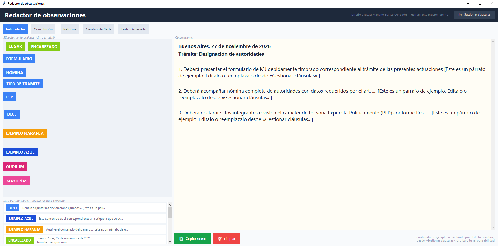
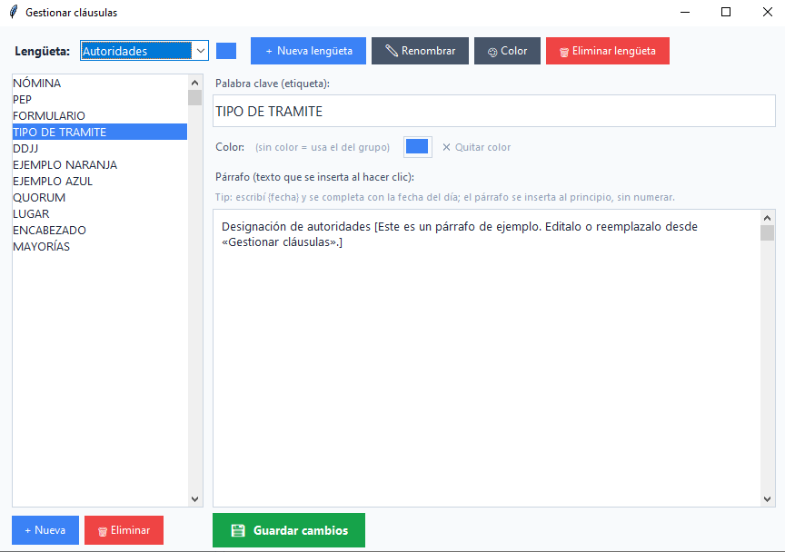

# Redactor de observaciones

Herramienta de apoyo para armar textos a partir de párrafos tipo («etiquetas»).
Se hace clic en una etiqueta (o se la arrastra hacia la derecha) y su párrafo se inserta, numerado, en el cuadro de observaciones. Después se copia con el botón **Copiar texto**.

Nació como una herramienta personal de trabajo, para agilizar la redacción de observaciones, y se comparte con quien quiera usarla.

*Diseño e ideas: Mariano Blanco Obregón · Programación asistida con IA (Claude)*
*Versión 1.0 · noviembre de 2026*

## Aviso importante

- La aplicación es de **uso libre**: puede usarla quien quiera.
- Los textos que trae (etiquetas y párrafos) son únicamente **ejemplos**, para mostrar cómo funciona la herramienta. Cada persona debe reemplazarlos por los de su propia temática desde **Gestionar cláusulas**, bajo su exclusiva responsabilidad, y verificar la normativa vigente antes de usarlos.
- Los ejemplos no son textos oficiales ni una fuente de información o de consulta para trámites ante la IGJ ni para ningún otro uso.
- No es una herramienta oficial de ningún organismo.
- Funciona **sin conexión**: no envía información a ningún lado. Todo queda en tu computadora. Aun así, no cargues datos personales ni reservados en las etiquetas.
- Se ofrece «tal cual», sin garantías.

## Cómo se organiza

- **Lengüetas:** cada lengüeta es una temática (por ejemplo, un tipo de trámite o un área de trabajo). Se pueden crear hasta 8.
- **Etiquetas:** dentro de cada lengüeta se crean las etiquetas. El nombre de la etiqueta indica el subtema, y su contenido es el párrafo (o los párrafos) que corresponden a ese subtema.
- **Colores:** cada etiqueta puede tener el color que elijas. Usá el mismo color para las etiquetas que comparten algún criterio, y así las identificás de un vistazo.
- **Posición:** podés mover cada etiqueta al lugar que prefieras dentro del área de trabajo, para tener a mano las que más usás y encontrarlas más rápido. La posición queda guardada.

## Cómo usarla

1. En la sección **Releases** de este repositorio, descargá el archivo `.zip` y descomprimilo en una carpeta (por ejemplo, en el Escritorio). Tienen que quedar juntos `RedactorObservaciones.exe` y `igj_clausulas.json`.
2. Abrí `RedactorObservaciones.exe`. No cambies el nombre del `.json` ni lo muevas de esa carpeta: la aplicación lo lee desde ahí y guarda en él tus cambios.
3. Windows puede mostrar el cartel «Windows protegió su PC». Es normal en programas sin firma digital. Elegí **Más información** y después **Ejecutar de todas formas**.
4. Hacé clic en una etiqueta para insertar su párrafo, o arrastrala hacia la derecha (vuelve sola a su lugar).
5. Pasando el mouse por la lista de abajo se ve el texto completo de cada etiqueta.

## Personalizarla

- **Gestionar cláusulas** permite crear, editar y eliminar etiquetas, cambiarles el color y administrar las lengüetas (hasta 8: crear, renombrar, cambiar el color y eliminar).
- Si escribís `{fecha}` en el texto de una etiqueta, se completa con la fecha del día y el párrafo se inserta al principio, sin numerar. Por ejemplo: `Buenos Aires, {fecha}. Trámite: Designación de autoridades`.
- Para empezar desde cero, borrá las etiquetas y lengüetas de ejemplo desde **Gestionar cláusulas** y creá las tuyas.
